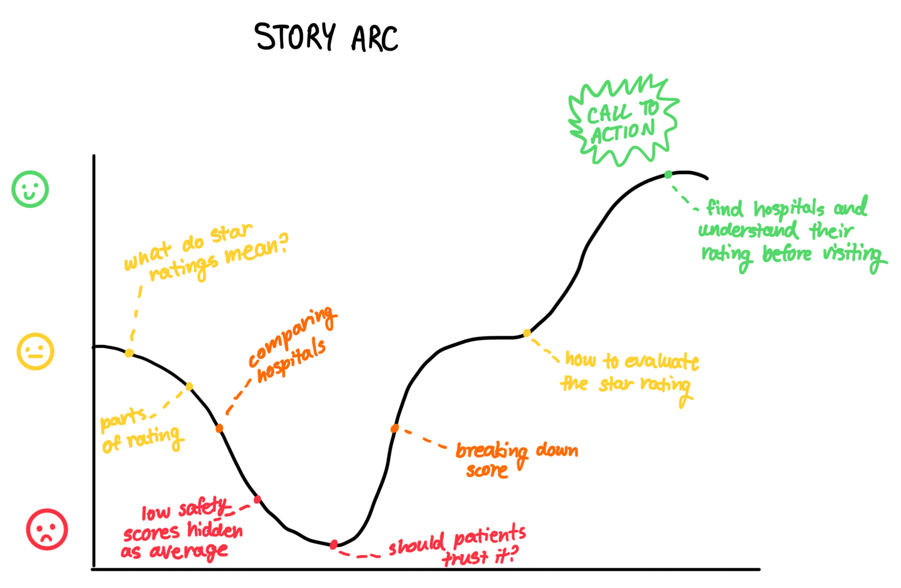
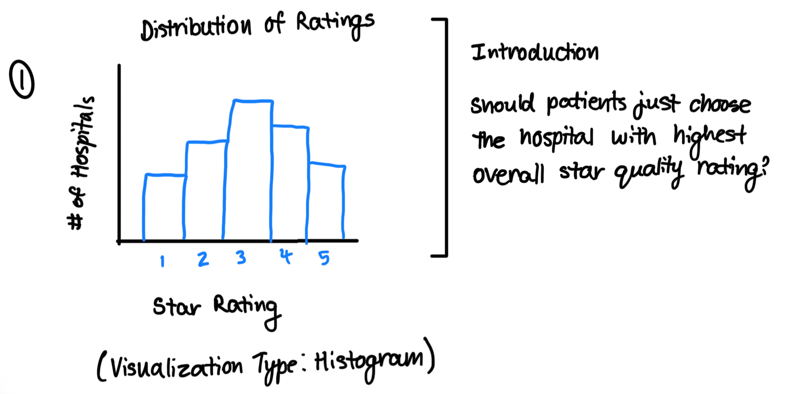
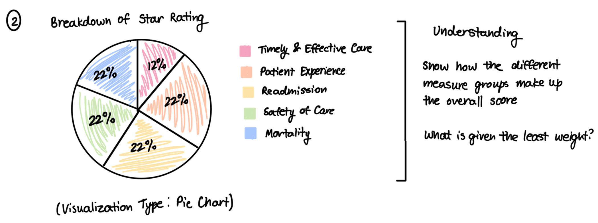
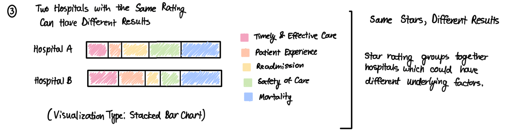
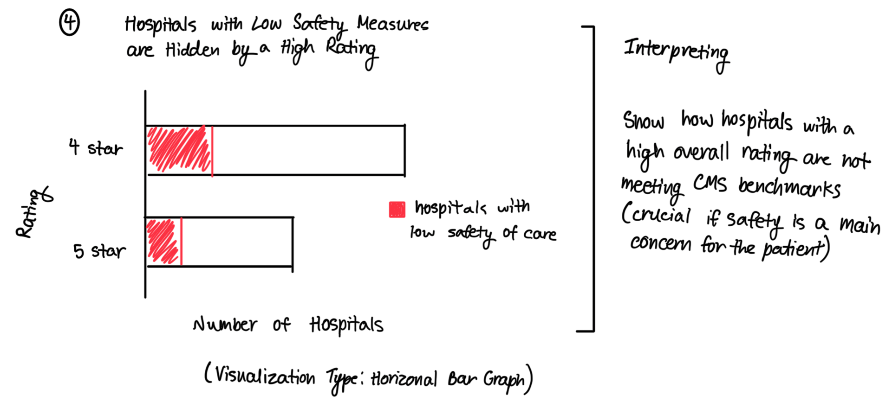
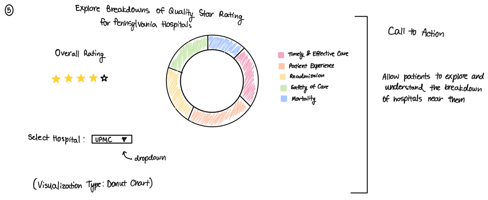

| [home page](https://esha-pandya0203.github.io/esha-pandya-portfolio/) | [visualizing government debt](visualizing-government-debt) | [covid case map](covid-cases-map) | [critique by design](critique-by-design) | [final project I](final-project-part-one) | [final project II](final-project-part-two) | [final project III](final-project-part-three) |

# Hidden in the Stars: Hospital Ratings Don’t Tell the Whole Story 
**One Sentence Summary**: Patients may not fully understand what goes into a hospital’s quality star rating, making it difficult to determine how much the rating should influence their choice of hospital. 

**Goal**: Patients should understand that the overall CMS star rating summarizes multiple aspects of hospital performance and does not necessarily reflect how a hospital performs on every individual quality measure.

# Outline
Central Question: How can patients interpret hospital quality star ratings and look beyond the overall score to make informed decisions about where to receive care?

The Center for Medicare and Medicaid Services (CMS) assigns hospitals an overall star rating which aggregates five categorical scores into a single rating. The measure groups included in the calculation are Mortality, Safety of Care, Readmission, Patient Experience, and Timely & Effective Care. The quality star rating is a weighted average of these measure groups, reflecting the quality of care of the hospital. 

Star ratings are useful to patients to evaluate hospital options and make informed choices about their place of care. Because patients use these ratings to make decisions about where to receive healthcare, it is important for them to fully understand the metrics that compose the overall rating. When two hospitals have the same star rating, it is difficult to know what the difference between them is without looking at the breakdown of the score. 

Focusing on Safety of Care and Patient Experience measure groups, I will highlight the hospitals with high (four to five) star ratings with selected individual measures performing worse than their applicable benchmarks for those groups (as defined by the CMS). CMS is placing an extra emphasis on the Safety of Care measure group. In 2026, hospitals in the lowest performing 25 percent in this measure group can only earn a maximum of 4 out of 5 start. Beginning in 2027, hospitals in the lowest quartile of the Safety of Care measure group will have its overall star rating reduced by 1 star for initial ratings of 2-5 stars. For the 2026 data, patients will be able to see which hospitals performed the lowest in Safety of Care while still achieving a respectable star rating. 

The goal of this project is to dive further into the composite scores of a hospital’s rating to understand the composite parts of the score. Patients can then use this breakdown to determine which hospitals meet the quality of care they are looking for. 

## Structure: 

1. **Introduction – What does a star rating actually mean?** 
- Story of a patient who needs medical care and is deciding which hospital to visit. 
- The patient finds a hospital with a four star overall rating, which seems reassuring at first glance. 
- Explain CMS’s hospital quality star rating and the 1-5 scale. 
- Show the distribution of overall hospital star ratings across Pennsylvania for context. (Sketch #1) 

2. **Understanding – What goes into a hospital’s rating?** 
- Five measure groups used in CMS rating methodology: mortality, safety of care, readmission, patient experience, and timely & effective care. 
- Explain how these groups contribute to overall rating (weighted average) and how weights change when a hospital does not report enough measures in a specific group. (Sketch #2) 
- Emphasize that overall rating is a summary of different aspects of quality, which can hide low, individual measures. 
- Introduce two comparable Pennsylvania hospitals with the same overall rating. 

3. **Same Stars, Different Results** 
- Compare the reported performance of Pennsylvania hospitals with the same overall rating, focusing on safety of care and patient experience measures. (Sketch #3) 
- Explore whether hospitals with higher overall ratings can still have individual measures that indicate less preferable performance. 
- Explain why high overall rating does not mean strong performance in each group. 

4. **Interpreting – How to understand a quality star rating?** 
- Investigate how many hospitals rated 4-5 stars have at least one selected safety measure performing worse than benchmark. (Sketch #4) 
- Explain how to interpret selected safety measures, patient experience measures, and readmission outcomes. 
- Show how to distinguish between an unfavorable reported result, a result similar to a benchmark, and a measure with insufficient or unavailable data. 
- Emphasize the importance of looking at more than one measure, understanding reporting limitations, and considering the type of care needed. 

5. **Conclusion – Call to Action** 
- Revisit the original patient scenario and demonstrate how the same hospital rating can be interpreted differently by breaking it down. 
- Summarize limitations of hospital quality ratings (i.e. missing information, reporting periods, differences in patients’ healthcare needs) 
- Encourage patients to use explorer → Interactive Pennsylvania hospital score breakdown (Sketch #5) 
- Call to Action → start with overall rating, look further into the score breakdown, consider what you need from your care and prioritize that instead of averaging all measures together 

## Story Arc:

# Initial sketches
The following sketches illustrate the proposed visualizations and interactive elements of the final project. They follow the story arc from introducing hospital star ratings to helping patients make more informed healthcare decisions. The visualizations are preliminary and may change based on data availability and findings. 

## Sketch #1: Distribution of Hospital Star Ratings 
This visualization introduces the distribution of overall hospital quality star ratings across Pennsylvania. It
provides context for the patient's initial impression of a four-star hospital.

## Sketch 2: Understanding the Rating Breakdown
This visualization explains the five CMS measure groups and their standard weights in the overall hospital quality
star rating. It helps readers understand how multiple aspects of care contribute to one rating.

## Sketch 3: Comparing Hospitals with the Same Rating
This visualization compares two Pennsylvania hospitals with the same overall star rating. It explores how
individual quality measures may differ despite an identical overall rating.

## Sketch 4: Highlighting Safety Concerns
This visualization investigates how many highly rated Pennsylvania hospitals have selected safety measures
performing worse than their published benchmarks. It represents the main turning point in the story.

## Sketch 5: Interactive Hospital Explorer
This proposed interactive feature allows patients to select a Pennsylvania hospital and explore its overall
star rating alongside selected quality measures. Readers can apply what they have learned to a
hospital they are considering.

# The data
The primary data for this project will come from the Centers for Medicare & Medicaid Services (CMS) Provider Data Catalog, which provides publicly accessible information about hospital quality and performance across the United States. The analysis will focus on hospitals in Pennsylvania, using the Hospital General Information dataset to identify hospitals and their overall quality star ratings. Additional datasets will provide individual measures related to healthcare-associated infections, patient experiences, readmissions, complications, mortality, and timely and effective care. These datasets will allow the project to examine the different dimensions of hospital quality that may not be apparent from an overall star rating alone.

The datasets will be prepared and analyzed using Python and pandas. Hospital records will be filtered to Pennsylvania and connected across datasets using hospital identifiers. The analysis will investigate how hospitals with similar overall star ratings differ on selected measures, with particular attention to safety and patient experience. The final project will also include an interactive hospital explorer, allowing readers to select a Pennsylvania hospital and examine available quality measures. Potential limitations include missing or unreported measures, differences in reporting periods, and the fact that hospital quality measures may not reflect every aspect of care relevant to an individual patient. The specific visualizations and comparisons may be adjusted based on data availability and the results of the analysis.

| Name | URL | Description |
|------|-----|-------------|
| Hospital General Information | https://data.cms.gov/provider-data/dataset/xubh-q36u | List of all hospitals registered with Medicare. Includes addresses, phone numbers, hospital type, and overall hospital rating. |
| Healthcare Associated Infections - Hospital | https://data.cms.gov/provider-data/dataset/77hc-ibv8#data-table | Provide information on infections that occur when the patient is in the hospital. Explores differences in safety performance for hospitals with the same overall rating. |
| Patient survey (HCAHPS) | https://data.cms.gov/provider-data/dataset/dgck-syfz | National, standardized survey of hospital patients about their experiences during an inpatient hospital stay. |
| Unplanned Hospital Visits - Hospital | https://data.cms.gov/provider-data/dataset/632h-zaca | Provider data for hospital return days, unplanned readmissions, and unplanned visits after outpatient procedures. |
| Complications and Deaths - Hospital | https://data.cms.gov/provider-data/dataset/ynj2-r877#data-table | Provider-level data for hip/knee complication measures, CMS patient safety indicators, and 30-day death rates. |
| Timely and Effective Care - Hospital | https://data.cms.gov/provider-data/dataset/yv7e-xc69 | Provider-level data for measures of cataract surgery outcome, colonoscopy follow-up, emergency department care, preventative care, and pregnancy & delivery care. |

# Method and medium
The final project will be presented as an interactive storytelling experience using Shorthand. Public hospital quality data from the Centers for Medicare & Medicaid Services (CMS) will be prepared and analyzed using Python and pandas, with a focus on hospitals in Pennsylvania. Tableau will be used to develop the data visualizations, including an interactive feature that allows readers to select a hospital and explore its reported quality measures. These visualizations will be integrated into the Shorthand narrative to guide readers from an introduction to hospital star ratings toward a more informed understanding of how to use quality information when evaluating hospitals. 

## References
- Calendar Year 2026 Hospital Outpatient Prospective Payment System (OPPS) and Ambulatory Surgical Center Final Rule (CMS-1834-FC) | CMS. (2026, November 4). https://www.cms.gov/newsroom/fact-sheets/calendar-year-2026-hospital-outpatient-prospective-payment-system-opps-ambulatory-surgical-center
- Complications and Deaths—Hospital | Provider Data Catalog. (n.d.). Retrieved November 16, 2026, from https://data.cms.gov/provider-data/dataset/ynj2-r877#data-table
- Healthcare Associated Infections—Hospital | Provider Data Catalog. (n.d.). Retrieved November 16, 2026, from https://data.cms.gov/provider-data/dataset/77hc-ibv8#data-table
- Hospital General Information | Provider Data Catalog. (n.d.). Retrieved November 16, 2026, from https://data.cms.gov/provider-data/dataset/xubh-q36u#data-table
- Hospitals—Overall hospital quality star rating | Provider Data Catalog. (n.d.). Retrieved November 16, 2026, from https://data.cms.gov/provider-data/topics/hospitals/overall-hospital-quality-star-rating/
- Patient survey (HCAHPS)—Hospital | Provider Data Catalog. (n.d.). Retrieved November 16, 2026, from https://data.cms.gov/provider-data/dataset/dgck-syfz#data-table
- Unplanned Hospital Visits—Hospital | Provider Data Catalog. (n.d.). Retrieved November 16, 2026, from https://data.cms.gov/provider-data/dataset/632h-zaca#data-table
- What Are Healthcare Star Ratings? (n.d.). PointClickCare. Retrieved November 16, 2026, from https://pointclickcare.com/glossary/healthcare-star-ratings/

## AI acknowledgements
I did not use AI to complete this Part 1 of the final project. 